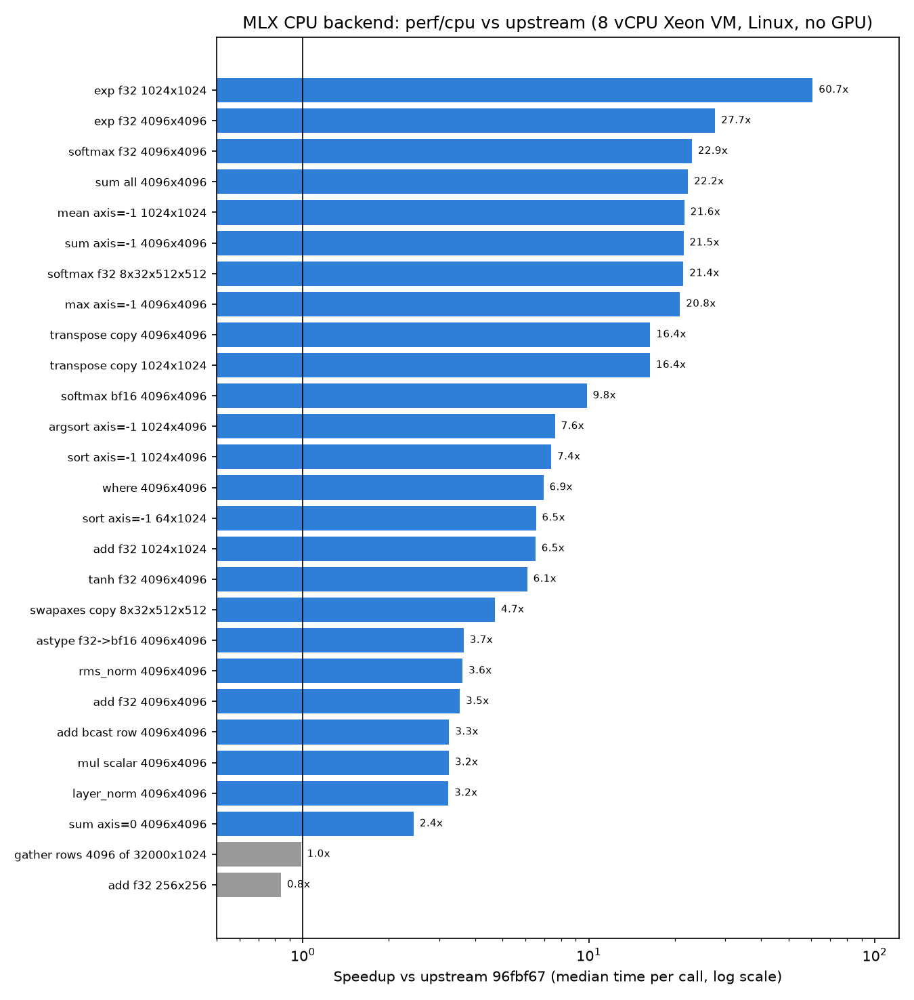

# CPU backend performance (`perf/cpu` branch)

This branch speeds up the hot paths of MLX's **CPU backend** on Linux/x86.
The baseline is upstream commit `96fbf67` ("Slightly clean up code"), which
`perf/cpu` branches from. Every number below was measured on the machine
described here. Nothing is projected or estimated.

**Summary.** On an 8 vCPU Xeon VM, the ops this branch changes run **2.4x to
61x** faster than upstream: `exp` 28x to 61x, float32 softmax 21x to 23x,
full and row reductions about 21x, transposes about 16x, sort/argsort about
7x, and large elementwise ops (add, mul, astype) 3.2x to 3.7x. The results were
measured in two separate sessions (2026-11-13 and 2026-11-15) and agree
within run-to-run noise. All C++ and Python tests pass, as they do on
upstream (with `g++` on `PATH`; see Correctness).

## Machine and build

- CPU: Intel Xeon VM, **8 vCPU** (8 cores, 1 thread per core, 1 socket,
  1 NUMA node), AVX2/AVX-512/FMA capable, L2 16 MiB total, **L3 320 MiB**.
- 16 GB RAM, Linux 6.12, **no GPU**.
- Compiler: GCC 13.4 (conda-forge), CMake 4.5, Python 3.12, OpenBLAS.
  Release build at `-O3` with the default x86-64 target (no
  `-march=native`, so no FMA or SSE4.1 at compile time).
- `MLX_BUILD_METAL=OFF`, `MLX_BUILD_CUDA=OFF`, shared library, Python
  bindings. The baseline and the branch were built with identical flags.

## Threads: `MLX_CPU_NUM_THREADS`

The branch adds a fork-join worker pool for intra-op parallelism. By
default it uses one thread per hardware thread (`std::thread::hardware_concurrency()`,
8 here), counting the calling thread.

- `MLX_CPU_NUM_THREADS=N` caps it at `N` threads. `1` turns intra-op
  parallelism off, which leaves only the single-threaded changes.
- The variable is read once, at the first parallel CPU op in the process.
  Set it before starting Python. Zero, negative and non-numeric values
  are ignored.
- Nested parallel regions, and two CPU streams running parallel kernels at
  the same time, fall back to running serially instead of oversubscribing.

## Method

`benchmarks/python/cpu_ops_bench.py`: each op runs 5 warmup evaluations,
then 15 rounds of 10 `mx.eval` calls. The tables show the median per-call
time across rounds, with `[min..max]` of the per-round means. Inputs are
fixed-seed and reused between iterations.

Upstream was benchmarked twice per session, once before and once after the
branch runs. **"Before" is the faster of the two upstream runs for each
op**, so run-to-run noise can only shrink the reported speedups, never grow
them. Large memory-bound ops are noisy on this VM: `add f32 4096x4096` on
upstream measured 24.2 ms and 32.8 ms in the two runs of the same session.

"1 thread" is the branch with `MLX_CPU_NUM_THREADS=1`. It isolates the
single-threaded changes (vectorized math, multiple accumulators, tiled
transposes) from the multithreading.

Raw JSON is in `benchmarks/results/cpu_perf/`: the 2026-11-15 runs at the
top level (these tables), the 2026-11-13 runs in `2026-11-13/`, an
interleaved single-thread check in `interleaved_1thread.json`, and the
compiler and flag comparison in `2026-11-15-clang/`.

## Results (2026-11-15)

| Op | Before (ms) | After (ms) | Speedup | After, 1 thread (ms) | Speedup, 1 thread |
|---|---:|---:|---:|---:|---:|
| add f32 256x256 | 0.021 [0.021..0.025] | 0.025 [0.019..0.027] | 0.84x | 0.021 | 0.98x |
| add f32 1024x1024 | 0.409 [0.391..0.511] | 0.063 [0.061..0.113] | 6.51x | 0.439 | 0.93x |
| add f32 4096x4096 | 24.238 [21.690..29.168] | 6.845 [6.347..11.389] | 3.54x | 29.732 | 0.82x |
| add bcast row 4096x4096 | 20.885 [19.566..23.628] | 6.426 [6.023..8.572] | 3.25x | 29.870 | 0.70x |
| mul scalar 4096x4096 | 20.546 [19.668..29.864] | 6.339 [5.952..7.513] | 3.24x | 26.856 | 0.77x |
| exp f32 1024x1024 | 14.308 [14.183..14.466] | 0.236 [0.217..0.486] | 60.72x | 1.797 | 7.96x |
| exp f32 4096x4096 | 256.619 [252.533..261.868] | 9.273 [8.801..13.438] | 27.67x | 50.170 | 5.12x |
| tanh f32 4096x4096 | 89.582 [84.586..100.296] | 14.703 [14.207..24.775] | 6.09x | 92.571 | 0.97x |
| where 4096x4096 | 102.332 [100.047..107.353] | 14.743 [14.137..15.996] | 6.94x | 88.104 | 1.16x |
| astype f32->bf16 4096x4096 | 13.556 [13.395..14.855] | 3.713 [3.527..4.268] | 3.65x | 16.029 | 0.85x |
| sum all 4096x4096 | 8.624 [8.578..8.644] | 0.388 [0.378..0.446] | 22.24x | 2.936 | 2.94x |
| sum axis=-1 4096x4096 | 8.453 [8.434..8.479] | 0.394 [0.384..0.749] | 21.45x | 2.945 | 2.87x |
| sum axis=0 4096x4096 | 2.813 [2.781..2.857] | 1.152 [1.129..1.363] | 2.44x | 2.996 | 0.94x |
| max axis=-1 4096x4096 | 16.797 [16.784..16.838] | 0.806 [0.766..0.991] | 20.85x | 6.168 | 2.72x |
| mean axis=-1 1024x1024 | 0.519 [0.514..0.607] | 0.024 [0.022..0.030] | 21.60x | 0.157 | 3.30x |
| softmax f32 4096x4096 | 272.232 [270.590..275.315] | 11.867 [11.316..12.721] | 22.94x | 75.886 | 3.59x |
| softmax f32 8x32x512x512 | 1072.387 [1065.593..1102.613] | 50.031 [46.180..55.203] | 21.43x | 319.726 | 3.35x |
| softmax bf16 4096x4096 | 268.071 [264.811..273.028] | 27.234 [26.586..33.502] | 9.84x | 190.381 | 1.41x |
| rms_norm 4096x4096 | 69.333 [66.922..73.356] | 19.155 [16.095..20.752] | 3.62x | 55.296 | 1.25x |
| layer_norm 4096x4096 | 98.290 [85.747..134.072] | 30.449 [29.293..37.740] | 3.23x | 106.788 | 0.92x |
| transpose copy 4096x4096 | 156.858 [152.138..167.416] | 9.557 [9.403..10.179] | 16.41x | 35.647 | 4.40x |
| transpose copy 1024x1024 | 4.053 [3.955..4.096] | 0.247 [0.231..0.342] | 16.38x | 1.023 | 3.96x |
| swapaxes copy 8x32x512x512 | 173.318 [162.780..185.760] | 36.884 [35.037..42.550] | 4.70x | 174.643 | 0.99x |
| gather rows 4096 of 32000x1024 | 1.187 [1.147..1.336] | 1.204 [1.175..1.258] | 0.99x | 1.135 | 1.05x |
| sort axis=-1 1024x4096 | 202.143 [200.659..203.931] | 27.346 [26.250..29.240] | 7.39x | 205.332 | 0.98x |
| argsort axis=-1 1024x4096 | 240.041 [239.056..243.113] | 31.500 [31.025..34.318] | 7.62x | 240.171 | 1.00x |
| sort axis=-1 64x1024 | 2.741 [2.704..2.833] | 0.419 [0.356..0.816] | 6.54x | 2.790 | 0.98x |



Reading the table:

- **Every op the branch changes is faster by more than the noise**, from
  2.4x (`sum axis=0`) to 61x (`exp` 1024x1024).
- `gather` was not changed and is a control: about 1.0x.
- `add f32 256x256` (65,536 elements) is the smallest size that gets split
  across threads: just 2 chunks. Waking a worker costs about as much as it
  saves at that size, so it measured 0.84x here (25 µs vs 21 µs) and 0.97x
  on 2026-11-13. From about 128K elements up, the split pays off (6.5x at
  1024x1024).
- `exp` and softmax gain the most. GCC didn't vectorize MLX's polynomial
  `exp` on x86 at all (see commit `c312552`), so it's 5x to 8x faster on one
  thread, and the threads multiply that.
- The 64 MB test arrays fit in this machine's 320 MiB L3, so the
  memory-bound results (add, copies, sums) are higher than you'd see on a
  machine with a small cache or less memory bandwidth.

### Single-threaded results and noise

In the full 1-thread run above, a few memory-bound rows show 0.70x to
0.94x. They're session noise, not slowdowns. The same build's
`add bcast row` measured 21.1 ms on 2026-11-13 and 29.9 ms here. To check,
upstream and the 1-thread branch were run alternately, three times each, for
those ops (`interleaved_1thread.json`):

| Op | Upstream (ms, 3 runs) | perf/cpu 1 thread (ms, 3 runs) | Ratio of medians |
|---|---|---|---:|
| add f32 4096x4096 | 25.6, 23.5, 29.8 | 25.4, 28.1, 25.4 | 1.01x |
| add bcast row 4096x4096 | 21.8, 25.5, 22.2 | 24.0, 27.7, 21.2 | 0.92x |
| mul scalar 4096x4096 | 25.6, 23.7, 21.1 | 21.5, 19.8, 20.1 | 1.18x |
| astype f32->bf16 4096x4096 | 15.1, 14.3, 14.0 | 14.1, 14.2, 14.4 | 1.01x |
| tanh f32 4096x4096 | 92.7, 87.1, 89.3 | 91.6, 93.6, 87.4 | 0.98x |
| sum axis=0 4096x4096 | 2.86, 3.06, 2.84 | 2.86, 3.06, 2.97 | 0.96x |
| layer_norm 4096x4096 | 93.7, 82.7, 93.3 | 76.1, 71.7, 73.5 | 1.27x |
| swapaxes copy 8x32x512x512 | 153.3, 164.3, 166.9 | 165.5, 171.7, 168.4 | 0.98x |
| add f32 1024x1024 | 0.42, 0.40, 0.42 | 0.40, 0.40, 0.44 | 1.06x |

Every ratio is inside the spread of upstream's own runs. Single-threaded,
the branch is no slower than upstream.

### Run-to-run check

Speedups from the two sessions, both computed with the faster-baseline rule
above. (The 2026-11-13 docs used the second baseline run instead, which
showed `add f32 1024x1024` as 6.27x and `mean` as 19.1x.)

| Op | 2026-11-13 | 2026-11-15 |
|---|---:|---:|
| add f32 256x256 | 0.97x | 0.84x |
| add f32 1024x1024 | 5.98x | 6.51x |
| add f32 4096x4096 | 3.47x | 3.54x |
| add bcast row 4096x4096 | 3.40x | 3.25x |
| mul scalar 4096x4096 | 3.49x | 3.24x |
| exp f32 1024x1024 | 62.69x | 60.72x |
| exp f32 4096x4096 | 26.37x | 27.67x |
| tanh f32 4096x4096 | 6.02x | 6.09x |
| where 4096x4096 | 7.03x | 6.94x |
| astype f32->bf16 4096x4096 | 3.54x | 3.65x |
| sum all 4096x4096 | 19.85x | 22.24x |
| sum axis=-1 4096x4096 | 19.49x | 21.45x |
| sum axis=0 4096x4096 | 2.35x | 2.44x |
| max axis=-1 4096x4096 | 20.85x | 20.85x |
| mean axis=-1 1024x1024 | 18.57x | 21.60x |
| softmax f32 4096x4096 | 21.46x | 22.94x |
| softmax f32 8x32x512x512 | 21.77x | 21.43x |
| softmax bf16 4096x4096 | 9.24x | 9.84x |
| rms_norm 4096x4096 | 3.61x | 3.62x |
| layer_norm 4096x4096 | 4.24x | 3.23x |
| transpose copy 4096x4096 | 19.61x | 16.41x |
| transpose copy 1024x1024 | 20.72x | 16.38x |
| swapaxes copy 8x32x512x512 | 5.18x | 4.70x |
| gather rows 4096 of 32000x1024 | 0.97x | 0.99x |
| sort axis=-1 1024x4096 | 7.41x | 7.39x |
| argsort axis=-1 1024x4096 | 7.38x | 7.62x |
| sort axis=-1 64x1024 | 7.81x | 6.54x |

The rows that moved most (`layer_norm`, the transposes, the small sort)
are the ones with the widest `[min..max]` spread within a single run.

## Compilers and flags (2026-11-15)

The tables above use GCC 13.4 at `-O3` for the default x86-64 target. To
check whether a different compiler or flags would do better, the branch
(`1a27421`) was built six ways and the full benchmark suite was run three
times per build, with the builds interleaved and the start order rotated
each round. Every Clang build used clang 19.1.7 (conda-forge) against the
same GCC 13.4 libstdc++ and sysroot, linked with lld. The table shows the
median of the three runs. "Speedup" is the GCC `-O3` time divided by the
other build's time, so above 1 means faster than GCC. Raw runs are in
`benchmarks/results/cpu_perf/2026-11-15-clang/flags_interleaved.json`.

| Op | GCC -O3 (ms) | clang -O3 | clang -O3 ThinLTO | clang -O3 -march=native | GCC -O3 -march=native |
|---|---:|---:|---:|---:|---:|
| where 4096x4096 | 21.76 | 2.50x | 2.21x | 2.55x | 1.06x |
| exp f32 1024x1024 | 0.481 | 1.11x | 1.10x | 4.26x | 0.74x |
| exp f32 4096x4096 | 13.02 | 0.92x | 1.06x | 1.50x | 0.82x |
| max axis=-1 4096x4096 | 1.585 | 1.10x | 1.09x | 1.66x | 1.00x |
| add f32 4096x4096 | 9.91 | 0.94x | 1.22x | 1.06x | 1.01x |
| mean axis=-1 1024x1024 | 0.038 | 0.27x | 0.65x | 1.04x | 0.96x |
| softmax f32 4096x4096 | 17.48 | 0.63x | 0.61x | 0.87x | 0.99x |
| softmax f32 8x32x512x512 | 65.94 | 0.58x | 0.57x | 0.85x | 0.93x |
| softmax bf16 4096x4096 | 38.54 | 0.90x | 0.90x | 1.19x | 1.30x |
| sort axis=-1 1024x4096 | 39.77 | 0.84x | 0.84x | 0.84x | 1.00x |
| argsort axis=-1 1024x4096 | 46.48 | 0.89x | 0.90x | 0.91x | 0.96x |
| **Geomean, all 27 ops** | | **0.95x** | **1.00x** | **1.18x** | **1.00x** |

A sixth build, clang `-O3 -fno-plt -fno-semantic-interposition`, came out
at 1.02x, within noise.

What this shows:

- **Switching to Clang doesn't help overall.** Plain clang `-O3` is 5%
  slower by geomean. It's much slower on float32 softmax (0.6x), sort
  (0.84x) and `mean` on 1024x1024 (0.27x), and faster only on `where`.
  ThinLTO brings it back to parity (1.00x), with no op clearly faster
  than GCC except `where`. `-fno-plt` changes nothing.
- **`-march=native` helps only with Clang.** clang `-O3 -march=native` is
  the only build that beats GCC overall (1.18x). Most of that is `exp`
  (4.3x at 1024x1024) and `max` (1.7x), from AVX-512 and FMA in the
  vectorized math. It's still slower on float32 softmax and sort. GCC with
  `-march=native` is a wash (1.00x) and is slower on `exp`. Both builds run
  only on CPUs with the build machine's instruction set, so neither is a
  default. To try it anyway:
  `cmake .. -DCMAKE_C_COMPILER=clang -DCMAKE_CXX_COMPILER=clang++ -DCMAKE_CXX_FLAGS=-march=native`.
- **`where` was a missed vectorization in GCC**, not a Clang advantage.
  GCC 13 can't vectorize `cond ? x : y` with a `bool` condition on x86, even
  with `-march=native`. Commit `24b9e0f` rewrites the contiguous case as a
  bitwise blend that both compilers vectorize. The GCC build is now as fast
  as Clang on `where`: 2.1x faster with 8 threads and 2.5x on 1 thread
  (`where_select.json`; measured on a loaded machine, so the times there
  are higher than in the table above). The `where` rows elsewhere in this
  file were measured before that commit.
- **Clang builds broke `mx.compile` on Linux.** The CPU JIT runs `g++` at
  run time, but CMake preprocessed its preamble with the build compiler, so
  every compiled kernel failed with Clang (upstream issue
  ml-explore/mlx#4577). Commit `340a079` preprocesses it with `g++` when the
  build compiler isn't GCC. All 24 C++ compile test cases now pass in the
  Clang build.

The default build stays GCC at `-O3` with no `-march` flag.

Limits of this comparison: one machine, one Clang version (19.1.7), one GCC
version (13.4). The interleaved runs were done before an unrelated build
started on the same machine. A separate single-thread round was dropped
because that build overlapped it. The Clang builds were not run through the
full test suite. Only the compile tests and Python `mx.compile` checks were
run on them.

## Changes (one commit each)

| Commit | Change | Ops it affects |
|---|---|---|
| `1ff67f3` | Fork-join worker pool + `parallel_for` (generation-tagged tickets, nested/concurrent regions run serially, short spin before sleeping, `MLX_CPU_NUM_THREADS`) | infrastructure |
| `1e6f08a` | Split unary ops across threads; keep the inner loop out of line so GCC vectorizes it | exp, tanh, abs, ... |
| `7b742b9` | Split binary ops (contiguous and broadcast) across threads | add, mul, comparisons, ... |
| `81f05c1` | Split ternary ops across threads | where |
| `71fff91` | 32x32 tiled transpose-like copies; split copies/fills across threads | contiguous(), transposes, astype, slice update |
| `c312552` | Make the simd math approximations vectorizable with GCC on x86: multiply-add instead of libm `std::fma` without FMA, exact branch-free float `floor`, and `-fno-trapping-math` on GCC (clang's default; results unchanged) | exp, softmax, sigmoid, sin/cos, erf, ... |
| `47667fe` | 8 independent accumulators in contiguous reductions when there's no SIMD type (also more accurate) | sum, max, min, mean, prod, all/any |
| `4994380` | Split reductions across threads (all-reduce, rows, strided blocks/columns) | sum, max, mean, ... |
| `eb2a1db` | Split softmax rows across threads | softmax |
| `25766a1` | Sort/argsort rows in parallel | sort, argsort |
| `fe0fa8e` | Targeted tests vs NumPy and the benchmark script | |
| `340a079` | Preprocess the CPU JIT preamble with `g++` in Clang builds on Linux (fixes `mx.compile` with Clang) | mx.compile |
| `24b9e0f` | Contiguous `where` as a bitwise blend that GCC vectorizes | where |

Later commits format code, add a missing include, make the report script
use the faster baseline run, and update these docs (no kernel changes). `rms_norm` and `layer_norm` use the composed fallback on CPU, so they
speed up through the elementwise and reduction changes.

## Correctness

Results from 2026-11-15, each C++ test case run in its own process. The
`perf/cpu` column was rerun at `24b9e0f`, with the `where` change.

| Suite | Upstream `96fbf67` | `perf/cpu` |
|---|---|---|
| C++ `tests` (doctest) | 243 / 243 pass | 243 / 243 pass |
| Python `python/tests` | 775 run: all pass, 60 skipped | 787 run (775 + 12 new): all pass, 60 skipped |
| New `python/tests/test_cpu_parallel.py` | 10 / 11 pass (fails the float32 sum accuracy check; the 12th test is newer) | 12 / 12 pass |

**`g++` must be on `PATH` for the `mx.compile` tests.** On CPU, MLX JIT-compiles
fused kernels by calling `g++` at runtime, and turns `mx.compile` off
when `g++ --version` fails. With only a prefixed cross compiler installed
(like conda's `x86_64-conda-linux-gnu-g++`), compile is silently off. Then
both builds fail the same 18 C++ compile tests and 9 Python tests
(8 in `test_compile` plus `test_vmap.test_broadcast_axes_vmap`). The table
above was run with a `g++` symlink to the conda compiler on `PATH`.

The new tests compare against NumPy at sizes that cross the chunking
thresholds (ragged chunks, broadcasting, strided/transposed inputs,
special values for `exp` and `floor`, NaN handling, stable argsort). They
also check that outputs with `MLX_CPU_NUM_THREADS=1` and `4` are bit-identical
and that two CPU streams can run parallel kernels at once.

Numerics:

- `exp`: max relative error over [-87, 87] is 3.85e-6 on both builds (the
  approximation is unchanged).
- Float sums are more accurate. For a 16M-element float32 sum, the max
  relative error vs float64 goes from 1.1e-4 (upstream) to 8.5e-7.
- Sums and products are reassociated, so float results can differ from
  upstream in the last bits, and an all-reduce result depends on the thread
  count.

## Reproduce

```bash
# Build (CPU only), from the repo root. Do the same in a checkout of
# upstream 96fbf67 for the baseline.
mkdir -p build && cd build
cmake .. -G Ninja -DCMAKE_BUILD_TYPE=Release -DMLX_BUILD_METAL=OFF \
  -DMLX_BUILD_CUDA=OFF -DMLX_BUILD_PYTHON_BINDINGS=ON -DMLX_BUILD_TESTS=ON \
  -DBUILD_SHARED_LIBS=ON -DMLX_PYTHON_BINDINGS_OUTPUT_DIRECTORY=$PWD/../python/mlx
ninja
cd ..
export PYTHONPATH=$PWD/python LD_LIBRARY_PATH=$PWD/build

# Benchmarks. Run upstream twice (before.json, before2.json), ideally once
# before and once after the branch runs.
python benchmarks/python/cpu_ops_bench.py --json after.json
MLX_CPU_NUM_THREADS=1 python benchmarks/python/cpu_ops_bench.py --json after_1t.json
python benchmarks/python/cpu_ops_report.py before.json before2.json \
  --after after.json --one-thread after_1t.json --chart speedup.png

# Tests. g++ must be on PATH or the mx.compile tests fail (see above).
python -m unittest discover python/tests
./build/tests/tests
```

`--filter SUBSTR` runs only the ops whose names contain `SUBSTR`.

## Limits

- **CPU only, Linux x86 only.** No Metal or CUDA numbers. Apple Silicon was
  not built or tested: the thread pool and parallel kernels also run there,
  but their effect next to Accelerate/NEON SIMD is unmeasured, and so is the
  thread-count default on mixed performance/efficiency cores. The
  `-fno-trapping-math` and `fma`/`floor` changes apply only to GCC / x86
  builds without FMA/SSE4.1 at compile time.
- **`mx.compile` graphs weren't benchmarked.** Compiled CPU graphs run as
  JIT-generated fused kernels, which don't use the elementwise paths
  changed here. The compile tests pass on both builds when `g++` is on
  `PATH` (see Correctness).
- **One machine**, an 8 vCPU VM with a very large L3. Memory-bound speedups
  depend on cache size and memory bandwidth, and large memory-bound ops vary
  by up to ~40% between runs on this VM.
- **The parallel grain is a fixed constant** (128 KB per thread), not tuned
  per op. Cheap elementwise ops right at the threshold (about 64K float32
  elements) gain nothing from the split and can lose a few microseconds.
- Intermediate commits were not built one at a time; the full branch was
  built and tested.
- Not touched: BLAS/matmul, conv, gather/scatter, scans, quantized ops.
