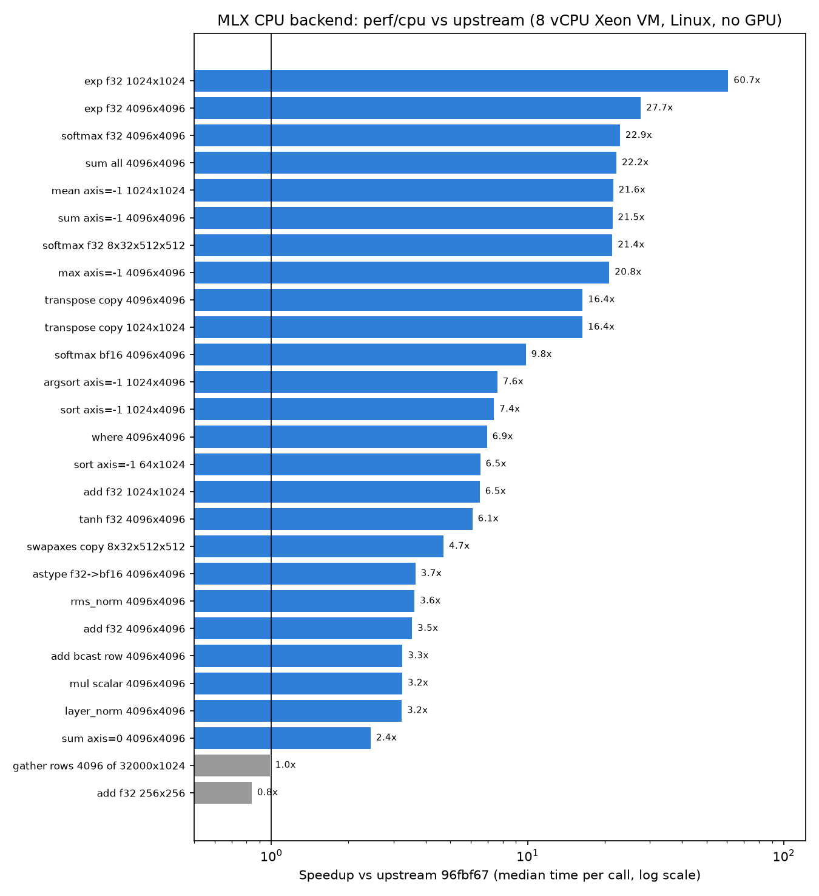

# MLX

[**Quickstart**](#quickstart) | [**Installation**](#installation) |
[**Documentation**](https://ml-explore.github.io/mlx/build/html/index.html) |
[**Examples**](#examples)

[](https://circleci.com/gh/ml-explore/mlx)

MLX is an array framework for machine learning on Apple silicon,
brought to you by Apple machine learning research.

Some key features of MLX include:

- **Familiar APIs**: MLX has a Python API that closely follows NumPy. MLX
   also has fully featured C++, [C](https://github.com/ml-explore/mlx-c), and
   [Swift](https://github.com/ml-explore/mlx-swift/) APIs, which closely mirror
   the Python API. MLX has higher-level packages like `mlx.nn` and
   `mlx.optimizers` with APIs that closely follow PyTorch to simplify building
   more complex models.

- **Composable function transformations**: MLX supports composable function
  transformations for automatic differentiation, automatic vectorization,
  and computation graph optimization.

- **Lazy computation**: Computations in MLX are lazy. Arrays are only
  materialized when needed.

- **Dynamic graph construction**: Computation graphs in MLX are constructed
  dynamically. Changing the shapes of function arguments does not trigger
  slow compilations, and debugging is simple and intuitive.

- **Multi-device**: Operations can run on any of the supported devices
  (currently the CPU and the GPU).

- **Unified memory**: A notable difference from MLX and other frameworks
  is the *unified memory model*. Arrays in MLX live in shared memory.
  Operations on MLX arrays can be performed on any of the supported
  device types without transferring data.

MLX is designed by machine learning researchers for machine learning
researchers. The framework is intended to be user-friendly, but still efficient
to train and deploy models. The design of the framework itself is also
conceptually simple. We intend to make it easy for researchers to extend and
improve MLX with the goal of quickly exploring new ideas.

The design of MLX is inspired by frameworks like
[NumPy](https://numpy.org/doc/stable/index.html),
[PyTorch](https://pytorch.org/), [Jax](https://github.com/google/jax), and
[ArrayFire](https://arrayfire.org/).

## Benchmarks (this fork: `perf/cpu`)

> This fork's `perf/cpu` branch speeds up MLX's **CPU backend** on Linux/x86:
> a worker pool for intra-op parallelism, multithreaded elementwise ops,
> copies, reductions, softmax and sort, tiled transposes, and a vectorized
> `exp`. Measured on an 8 vCPU Intel Xeon VM (320 MiB L3, **no GPU**), GCC 13,
> upstream `96fbf67` vs `perf/cpu`, median time per call over 15 rounds of 10
> calls, baseline = the faster of two upstream runs. Metal, CUDA and Apple
> Silicon were not measured. Full method, all 27 ops, single-thread numbers,
> a second session's results and the limits are in [PERF.md](PERF.md) and
> [docs/mlx-cpu-perf.pdf](docs/mlx-cpu-perf.pdf).

| Op (float32) | Upstream (ms) | perf/cpu (ms) | Speedup |
|---|---:|---:|---:|
| add f32 4096x4096 | 24.24 | 6.84 | 3.5x |
| add bcast row 4096x4096 | 20.88 | 6.43 | 3.3x |
| exp f32 1024x1024 | 14.31 | 0.24 | 60.7x |
| exp f32 4096x4096 | 256.62 | 9.27 | 27.7x |
| tanh f32 4096x4096 | 89.58 | 14.70 | 6.1x |
| where 4096x4096 | 102.33 | 14.74 | 6.9x |
| sum all 4096x4096 | 8.62 | 0.39 | 22.2x |
| sum axis=0 4096x4096 | 2.81 | 1.15 | 2.4x |
| max axis=-1 4096x4096 | 16.80 | 0.81 | 20.8x |
| softmax f32 4096x4096 | 272.23 | 11.87 | 22.9x |
| softmax f32 8x32x512x512 | 1072.39 | 50.03 | 21.4x |
| rms_norm 4096x4096 | 69.33 | 19.15 | 3.6x |
| layer_norm 4096x4096 | 98.29 | 30.45 | 3.2x |
| transpose copy 4096x4096 | 156.86 | 9.56 | 16.4x |
| swapaxes copy 8x32x512x512 | 173.32 | 36.88 | 4.7x |
| sort axis=-1 1024x4096 | 202.14 | 27.35 | 7.4x |
| argsort axis=-1 1024x4096 | 240.04 | 31.50 | 7.6x |
| gather rows 4096 of 32000x1024 | 1.19 | 1.20 | 1.0x |



`gather` was not changed and is shown as a control. Set
`MLX_CPU_NUM_THREADS=N` to cap the thread count (`1` turns the parallelism
off). All C++ and Python tests pass, plus 11 new ones in
`python/tests/test_cpu_parallel.py`. To reproduce, build with
`-DMLX_BUILD_METAL=OFF -DMLX_BUILD_CUDA=OFF`, then run
`python benchmarks/python/cpu_ops_bench.py` on this branch and on upstream
(full commands in [PERF.md](PERF.md#reproduce)).

## Examples

The [MLX examples repo](https://github.com/ml-explore/mlx-examples) has a
variety of examples, including:

- [Transformer language model](https://github.com/ml-explore/mlx-examples/tree/main/transformer_lm) training.
- Large-scale text generation with
  [LLaMA](https://github.com/ml-explore/mlx-examples/tree/main/llms/llama) and
  finetuning with [LoRA](https://github.com/ml-explore/mlx-examples/tree/main/lora).
- Generating images with [Stable Diffusion](https://github.com/ml-explore/mlx-examples/tree/main/stable_diffusion).
- Speech recognition with [OpenAI's Whisper](https://github.com/ml-explore/mlx-examples/tree/main/whisper).

## Quickstart

See the [quick start
guide](https://ml-explore.github.io/mlx/build/html/usage/quick_start.html)
in the documentation.

## Installation

MLX is available on [PyPI](https://pypi.org/project/mlx/). To install MLX on
macOS, run:

```bash
pip install mlx
```

To install the CUDA backend on Linux, run:

```bash
pip install mlx[cuda]
```

To install a CPU-only Linux package, run:

```bash
pip install mlx[cpu]
```

Checkout the
[documentation](https://ml-explore.github.io/mlx/build/html/install.html#)
for more information on building the C++ and Python APIs from source.

## Contributing

Check out the [contribution guidelines](https://github.com/ml-explore/mlx/tree/main/CONTRIBUTING.md) for more information
on contributing to MLX. See the
[docs](https://ml-explore.github.io/mlx/build/html/install.html) for more
information on building from source, and running tests.

We are grateful for all of [our
contributors](https://github.com/ml-explore/mlx/tree/main/ACKNOWLEDGMENTS.md#Individual-Contributors). If you contribute
to MLX and wish to be acknowledged, please add your name to the list in your
pull request.

## Citing MLX

The MLX software suite was initially developed with equal contribution by Awni
Hannun, Jagrit Digani, Angelos Katharopoulos, and Ronan Collobert. If you find
MLX useful in your research and wish to cite it, please use the following
BibTex entry:

```text
@software{mlx2023,
  author = {Awni Hannun and Jagrit Digani and Angelos Katharopoulos and Ronan Collobert},
  title = {{MLX}: Efficient and flexible machine learning on Apple silicon},
  url = {https://github.com/ml-explore},
  version = {0.0},
  year = {2023},
}
```
